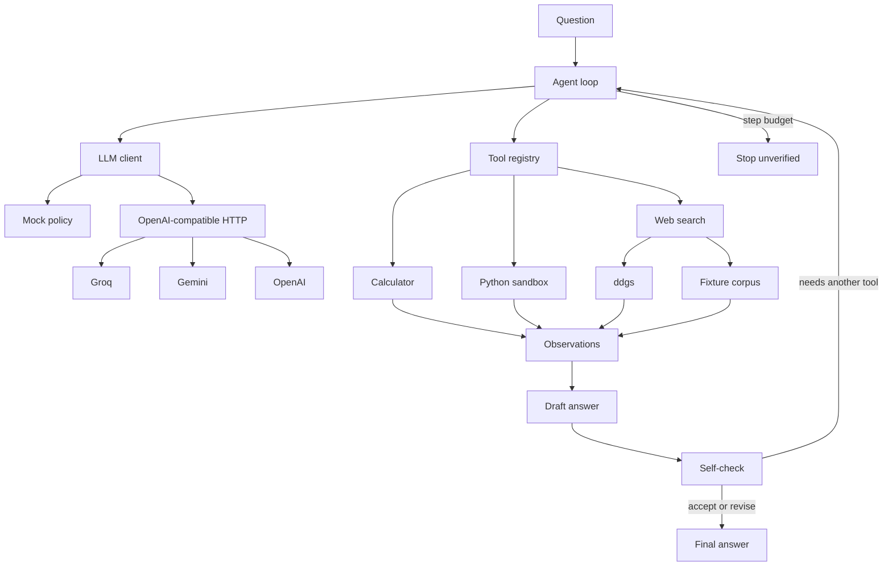

# mini-agent

A small tool-calling agent you can read in an afternoon. The model plans and asks for tools. This process is the only thing that runs them. A draft answer is not returned until a self-check accepts or revises it. There is a step budget, an offline mock that needs no API key, and a fixed eval so a change to the loop has a number attached.

Kevin Fairley built it as a portfolio piece for agentic AI and AI research roles: the loop, the tools, and the measurement are all small enough to defend in an interview.

## Architecture



One model call is one step. A step either calls tools or writes text. Text is a draft. The loop then sends a self-check and spends another step. Tool errors come back as observations, so the next step can recover. If the budget runs out first, the result is marked unverified and is not scored as a pass.

## Quickstart

Requires Python 3.11+.

```bash
python -m venv .venv
source .venv/bin/activate
pip install -e ".[dev]"

mini-agent "What is (17 * 23) + 5?"
mini-agent "Use Python to compute the 10th Fibonacci number. The sequence starts 1, 1, 2, 3, 5."
mini-agent "What is the capital of France?"
mini-agent-eval
pytest
```

With no API key, `mini-agent` uses the deterministic mock and says so. `mini-agent-eval` always defaults to the mock, even if a key is set, so the command cannot quietly turn into a hosted-model run.

The same entry points work as `python -m mini_agent` and `python -m mini_agent.eval`.

### A trace

`mini-agent --mock "What is (17 * 23) + 5?"` prints the plan, the observation, the draft, and the self-check:

```text
step 1  act
The question is arithmetic, so I'll evaluate it with the calculator.
call calculator
{"expression": "(17 * 23) + 5"}
observe
396

step 2  draft
396

step 3  reflect  accept
The draft is grounded in the latest tool observation.

answer
396
3 steps · reflected
```

`--json` prints the same run as a single object. `--max-steps` is the budget (default 8). Exit code 0 means the self-check finished. Exit code 2 means the budget won.

## Providers

The client is one HTTP POST to `{base}/chat/completions` with the OpenAI tool schema. Groq, Gemini, and OpenAI are presets, not separate integrations. There is no provider SDK.

| Provider | `LLM_BASE_URL` | Default `LLM_MODEL` | Key variable |
| --- | --- | --- | --- |
| groq | `https://api.groq.com/openai/v1` | `llama-3.3-70b-versatile` | `GROQ_API_KEY` |
| gemini | `https://generativelanguage.googleapis.com/v1beta/openai/` | `gemini-3.8-flash` | `GEMINI_API_KEY` |
| openai | `https://api.openai.com/v1` | `gpt-4.1-mini` | `OPENAI_API_KEY` |

`llama-3.3-70b-versatile` is a current Groq production model with tool use. `llama-3.1-8b-instant` is the faster Groq option if you set `LLM_MODEL`. Gemini's model id is the one in Google's OpenAI-compatibility docs. `gpt-4.1-mini` still serves chat completions; OpenAI's deprecation notice lists `gpt-6-luna` as its replacement and a removal date of 2027-01-14. Set `LLM_MODEL` to the id your account actually has.

`LLM_API_KEY` wins over the provider-specific variable. Copy `.env.example` to `.env` in the working directory if you want the CLI to load it. Values already in the environment win. pytest does not read `.env`.

Resolution order for `mini-agent`:

1. `--mock`, or `--provider`.
2. `LLM_PROVIDER` (`mock`, `groq`, `gemini`, `openai`, `custom`).
3. `LLM_API_KEY`, with the host inferred from `LLM_BASE_URL` (empty or Groq → groq, Gemini's host → gemini, `api.openai.com` → openai, anything else → custom).
4. `GROQ_API_KEY`, then `GEMINI_API_KEY`, then `OPENAI_API_KEY`.
5. Otherwise the mock.

`custom` needs `LLM_BASE_URL`, `LLM_MODEL`, and `LLM_API_KEY`. `LLM_TIMEOUT` (seconds, default 60) and `LLM_MAX_TOKENS` (default 1024) are optional.

## Tools

| Tool | What it does |
| --- | --- |
| `calculator` | One arithmetic expression. Fail-closed AST walk: numbers, `+ - * / // % **`, parentheses. No `eval`. |
| `python` | A snippet in a subprocess with a wall-clock timeout, `python -I`, a clean environment, and `ulimit` on CPU, file size, and address space. An AST policy blocks `os`, `subprocess`, `socket`, `open`, and dunder escapes. |
| `web_search` | Live search through [`ddgs`](https://pypi.org/project/ddgs/), or a five-snippet fixture corpus. The observation says which source it used. Snippets are labeled as data, not instructions. |

Register anything with a name, a JSON schema, and a function. The model sees an OpenAI function schema on the next turn. Exceptions become `Error:` observations.

```python
from mini_agent.tools import Tool, build_registry

registry = build_registry("fixture")
registry.register(Tool(
    name="echo",
    description="Repeat text.",
    parameters={
        "type": "object",
        "properties": {"text": {"type": "string"}},
        "required": ["text"],
    },
    handler=lambda arguments: arguments["text"],
))
```

The Python runner is a local guard for the agent's own snippets, not a jail for hostile code. A determined snippet can still escape an AST denylist. Do not point it at untrusted users.

Search mode is `--search auto|live|fixture`, or `MINI_AGENT_SEARCH`. `auto` is the fixture corpus for the mock and live `ddgs` otherwise. `ddgs` is imported only when a live search actually runs.

## Evaluation

Fifteen fixed tasks: five arithmetic, five programs, five facts. A task passes only when the self-check finished and the answer matches a checker (a number within tolerance, a substring, or a regex). The checker never sees which tool ran.

```bash
mini-agent-eval
```

That writes `reports/eval_results.md` and `reports/eval_results.json` and prints the markdown. `reports/` is gitignored.

### Mock-mode results

These numbers are from one local run of `mini-agent-eval` on 2026-11-08T03:21:47Z. Re-running moves the latency. It does not change the pass/fail result or the step count, which the tests lock in. This is the mock policy plus the offline fixture corpus. It is not a Groq, Gemini, or OpenAI score.

The mock does not look up these labels. Arithmetic answers are whatever the calculator returns. Code answers are the last line of sandbox stdout. Factual answers are the matching fixture snippet, copied through the observation. The five snippets live in `src/mini_agent/tools/web_search.py`. An unknown fact stays unanswered. "What is the capital of Atlantis?" does not come back as Paris.

| Metric | Value |
| --- | --- |
| Mode | mock |
| Provider | mock |
| Model | mock |
| Search | fixture |
| Tasks | 15 |
| Passed | 15 |
| Success rate | 100% |
| Average steps | 3.00 |
| Average latency | 3.36 ms |

| Category | Passed | Total |
| --- | --- | --- |
| math | 5 | 5 |
| code | 5 | 5 |
| factual | 5 | 5 |

| id | category | pass | steps | latency_ms | answer |
| --- | --- | --- | --- | --- | --- |
| math-multiply-add | math | yes | 3 | 0.15 | 396 |
| math-power | math | yes | 3 | 0.07 | 1024 |
| math-sqrt | math | yes | 3 | 0.06 | 12 |
| math-parentheses | math | yes | 3 | 0.07 | 26 |
| math-division | math | yes | 3 | 0.06 | 32 |
| code-sum-squares | code | yes | 3 | 10.51 | 385 |
| code-fibonacci | code | yes | 3 | 10.58 | 55 |
| code-factorial | code | yes | 3 | 10.26 | 5040 |
| code-primes | code | yes | 3 | 9.25 | 15 |
| code-reverse | code | yes | 3 | 9.07 | citnega |
| fact-france-capital | factual | yes | 3 | 0.14 | The capital of France is Paris. |
| fact-moon-landing | factual | yes | 3 | 0.05 | The first crewed Moon landing was in 1969. |
| fact-gold-symbol | factual | yes | 3 | 0.04 | The chemical symbol for gold is Au. |
| fact-gatsby-author | factual | yes | 3 | 0.04 | The Great Gatsby was written by F. Scott Fitzgerald. |
| fact-water-boiling | factual | yes | 3 | 0.06 | The boiling point of water at sea level is 100 degrees Celsius. |

### Groq results

Not measured. Do not paste the mock table here.

```bash
export GROQ_API_KEY="gsk_..."
# optional; these are already the defaults
export LLM_BASE_URL="https://api.groq.com/openai/v1"
export LLM_MODEL="llama-3.3-70b-versatile"

mini-agent "What is (17 * 23) + 5?"
mini-agent "Use Python to compute the 10th Fibonacci number. The sequence starts 1, 1, 2, 3, 5."
mini-agent "What is the capital of France?"

# fixture search: the model, without live web flakiness
mini-agent-eval --provider groq --search fixture --output-dir reports/groq-fixture

# live ddgs
mini-agent-eval --provider groq --search live --output-dir reports/groq
```

`LLM_API_KEY` may be set instead of `GROQ_API_KEY`. After a real run, paste the summary from `reports/groq/eval_results.md` under this heading. Live snippets will not always contain the phrase the checker looks for, so a hosted score below 100% is a real result, not a failed install.

Gemini and OpenAI use the same eval command with `--provider gemini` or `--provider openai` and the matching key.

## Design decisions

**The runtime owns execution.** The model can only ask. Tool results enter the transcript through the registry, including failures.

**The self-check is a state, not a sentence in the system prompt.** The loop will not return a draft until the next model call accepts or revises it. "Verified" means that call happened. It does not mean the answer is correct. The eval is what checks correctness.

**The step budget counts model calls.** Tool execution happens inside the call that requested it. A model that keeps calling tools stops at the budget and the answer is unverified. Default is 8, hard cap 30.

**Arithmetic does not go through the sandbox.** The calculator walks an AST and rejects anything that is not an operator or a number, including huge exponents. Algorithms go to Python, where the result is computed rather than recalled.

**The HTTP client is urllib.** The tool-calling protocol is the whole client, and the runtime dependencies are `ddgs` and `rich`. Presets differ by base URL, model id, and which environment variable holds the key.

**The mock is a policy.** It chooses calculator, Python, or search from the wording of the question, then drafts from the observation. Generalization tests ask for a factorial, a root, and a string that are not in the 15-task set. Unknown search queries produce "I could not find a sourced answer," not a guess.

**Eval defaults to mock.** A key in the environment must not change `mini-agent-eval` into a paid run or a number that looks like a model benchmark.

## Roadmap

- Token and cost columns on the trace.
- Concurrent execution when one step requests tools that do not depend on each other.
- A real sandbox (bubblewrap or a container) before this ever runs untrusted model output for someone else.
- A local retrieval tool beside web search.
- A checked-in Groq eval once a key is available to CI as a secret.
- OpenTelemetry spans for the same trace the CLI already prints.

## Development

```bash
pytest
mini-agent-eval
```

GitHub Actions runs both on Python 3.11 and 3.12. The eval there is mock mode only.

## Layout

```text
src/mini_agent/
  agent.py            loop: act, draft, self-check, step budget
  mock_llm.py         deterministic tool-using policy
  llm.py              OpenAI-compatible chat completions
  config.py           env presets and .env loading
  prompts.py          system prompt and self-check turn
  cli.py              mini-agent
  trace.py            rich rendering
  tools/              registry, calculator, python, web search
  eval/               tasks, scoring, markdown and JSON report
tests/                mock and scripted-model unit tests
```

## License

MIT. See [LICENSE](LICENSE).
