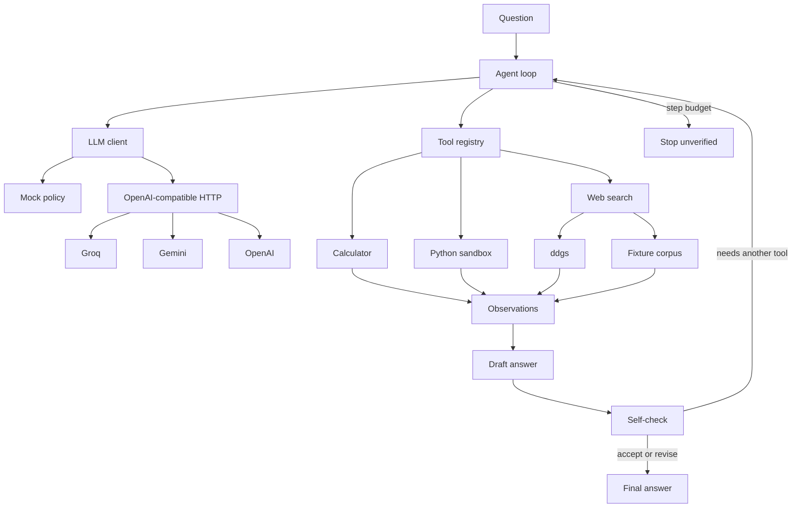

# mini-agent

[](https://github.com/kfairy9999/mini-agent/actions/workflows/ci.yml)
[](LICENSE)
[](pyproject.toml)

mini-agent is a Python 3.11 tool-calling loop Kevin Fairley wrote for agentic AI roles. The model may ask for a calculator, a short Python program, or a web search; this process is the only thing that runs the tool; and a draft is not returned until a self-check accepts or revises it. The same loop runs offline with no key, and a 15-task eval has a measured Groq result: `qwen/qwen3.8-27b`, fixture search, 14 of 15 on 2026-11-08.

## Architecture



One model call is one step. A step either calls tools or writes text. Text is a draft. The loop then sends a self-check and spends another step. Tool errors come back as observations, so the next step can recover. If the budget runs out first, the result is marked unverified and is not scored as a pass.

## Quickstart

Requires Python 3.11+.

```bash
python -m venv .venv
source .venv/bin/activate
pip install -e ".[dev]"

mini-agent "What is (17 * 23) + 5?"
mini-agent "Use Python to compute the 10th Fibonacci number. The sequence starts 1, 1, 2, 3, 5."
mini-agent "What is the capital of France?"
mini-agent-eval
pytest
```

With no API key, `mini-agent` uses the deterministic mock and says so. `mini-agent-eval` always defaults to the mock, even if a key is set, so the command cannot quietly turn into a hosted-model run.

The same entry points work as `python -m mini_agent` and `python -m mini_agent.eval`.

### A trace from the Groq run

`math-multiply-add` on `qwen/qwen3.8-27b` (fixture search, 2026-11-08T03:56:06Z) finished in 3 steps. The self-check accepted the draft (`verified: true`, `stop_reason: reflected`). The recorded answer is `(17 × 23) + 5 = 396.` Latency was 735.96 ms, before the free-tier token bucket filled. The eval file stores that outcome, not the tool arguments or the reflection notes.

```text
qwen/qwen3.8-27b  ·  math-multiply-add  ·  735.96 ms

step 1  act
call calculator

step 2  draft
(17 × 23) + 5 = 396.

step 3  reflect  accept

answer
(17 × 23) + 5 = 396.
3 steps · reflected · verified
```

`mini-agent --mock "What is (17 * 23) + 5?"` prints the same three-step shape with no key. `--json` prints one object. `--max-steps` is the budget (default 8). Exit code 0 means the self-check finished. Exit code 2 means the budget won.

## Providers

The client is one HTTP POST to `{base}/chat/completions` with the OpenAI tool schema. Groq, Gemini, and OpenAI are presets, not separate integrations. There is no provider SDK.

| Provider | `LLM_BASE_URL` | Default `LLM_MODEL` | Key variable |
| --- | --- | --- | --- |
| groq | `https://api.groq.com/openai/v1` | `qwen/qwen3.8-27b` | `GROQ_API_KEY` |
| gemini | `https://generativelanguage.googleapis.com/v1beta/openai/` | `gemini-3.8-flash` | `GEMINI_API_KEY` |
| openai | `https://api.openai.com/v1` | `gpt-4.1-mini` | `OPENAI_API_KEY` |

`qwen/qwen3.8-27b` is the Groq default: it is on the current model list and it tool-calls. `llama-3.3-70b-versatile` now returns 404. `openai/gpt-oss-120b` and `openai/gpt-oss-20b` are also on that list. gpt-oss sometimes emits a tool named `json`, which Groq rejects with HTTP 400 because that name was not in the request. The client retries that turn once and tells the model which tools actually exist. If the same 400 comes back, the call fails with that error instead of crashing the loop.

Cloudflare answers `api.groq.com` with error 1010 when the client sends urllib's default `Python-urllib` User-Agent. The client sends `mini-agent/<version>` instead.

A free-tier key 429s after a couple of tasks if calls go out back to back. A 429 is retried using `Retry-After`, `x-ratelimit-reset-*`, or the "try again in …" text in the body, plus a short cushion. That wait becomes the gap before later calls on the same client. The eval runs one task at a time on one client, and a task that still exhausts the budget is tried again. If it is still rate-limited, the report marks it `rate limit` and leaves it out of the success rate. It is not scored as a wrong answer. `LLM_MIN_INTERVAL` (seconds, default 0) sets a gap before the first 429, and `LLM_MAX_RETRIES` (default 8) is the per-call retry budget.

Gemini's model id is the one in Google's OpenAI-compatibility docs. `gpt-4.1-mini` still serves chat completions; OpenAI's deprecation notice lists `gpt-6-luna` as its replacement and a removal date of 2027-01-14. Set `LLM_MODEL` to the id your account actually has.

`LLM_API_KEY` wins over the provider-specific variable. Copy `.env.example` to `.env` in the working directory if you want the CLI to load it. Values already in the environment win. pytest does not read `.env`.

Resolution order for `mini-agent`:

1. `--mock`, or `--provider`.
2. `LLM_PROVIDER` (`mock`, `groq`, `gemini`, `openai`, `custom`).
3. `LLM_API_KEY`, with the host inferred from `LLM_BASE_URL` (empty or Groq → groq, Gemini's host → gemini, `api.openai.com` → openai, anything else → custom).
4. `GROQ_API_KEY`, then `GEMINI_API_KEY`, then `OPENAI_API_KEY`.
5. Otherwise the mock.

`custom` needs `LLM_BASE_URL`, `LLM_MODEL`, and `LLM_API_KEY`. `LLM_TIMEOUT` (seconds, default 60), `LLM_MAX_TOKENS` (default 1024), `LLM_MIN_INTERVAL` (default 0), and `LLM_MAX_RETRIES` (default 8) are optional.

## Tools

| Tool | What it does |
| --- | --- |
| `calculator` | One arithmetic expression. Fail-closed AST walk: numbers, `+ - * / // % **`, parentheses. No `eval`. |
| `python` | A snippet in a subprocess with a wall-clock timeout, `python -I`, a clean environment, and `ulimit` on CPU, file size, and address space. An AST policy blocks `os`, `subprocess`, `socket`, `open`, and dunder escapes. |
| `web_search` | Live search through [`ddgs`](https://pypi.org/project/ddgs/), or a five-snippet fixture corpus. The observation says which source it used. Snippets are labeled as data, not instructions. |

Register anything with a name, a JSON schema, and a function. The model sees an OpenAI function schema on the next turn. Exceptions become `Error:` observations.

```python
from mini_agent.tools import Tool, build_registry

registry = build_registry("fixture")
registry.register(Tool(
    name="echo",
    description="Repeat text.",
    parameters={
        "type": "object",
        "properties": {"text": {"type": "string"}},
        "required": ["text"],
    },
    handler=lambda arguments: arguments["text"],
))
```

The Python runner is a local guard for the agent's own snippets, not a jail for hostile code. A determined snippet can still escape an AST denylist. Do not point it at untrusted users.

Search mode is `--search auto|live|fixture`, or `MINI_AGENT_SEARCH`. `auto` is the fixture corpus for the mock and live `ddgs` otherwise. `ddgs` is imported only when a live search actually runs.

## Evaluation

Fifteen fixed tasks: five arithmetic, five programs, five facts. A task passes only when the self-check finished and the answer matches a checker (a number within tolerance, a substring, or a regex). The checker never sees which tool ran.

```bash
mini-agent-eval
```

That writes `reports/eval_results.md` and `reports/eval_results.json` and prints the markdown. `reports/` is gitignored.

### Mock-mode results

These numbers are from one local run of `mini-agent-eval` on 2026-11-08T03:21:47Z. Re-running moves the latency. It does not change the pass/fail result or the step count, which the tests lock in. This is the mock policy plus the offline fixture corpus. It is not a Groq, Gemini, or OpenAI score. A current report also lists rate-limited tasks. This run had none, so the success rate is 15/15. Rate-limited rows are left out of that rate.

The mock does not look up these labels. Arithmetic answers are whatever the calculator returns. Code answers are the last line of sandbox stdout. Factual answers are the matching fixture snippet, copied through the observation. The five snippets live in `src/mini_agent/tools/web_search.py`. An unknown fact stays unanswered. "What is the capital of Atlantis?" does not come back as Paris.

| Metric | Value |
| --- | --- |
| Mode | mock |
| Provider | mock |
| Model | mock |
| Search | fixture |
| Tasks | 15 |
| Passed | 15 |
| Success rate | 100% |
| Average steps | 3.00 |
| Average latency | 3.36 ms |

| Category | Passed | Total |
| --- | --- | --- |
| math | 5 | 5 |
| code | 5 | 5 |
| factual | 5 | 5 |

| id | category | pass | steps | latency_ms | answer |
| --- | --- | --- | --- | --- | --- |
| math-multiply-add | math | yes | 3 | 0.15 | 396 |
| math-power | math | yes | 3 | 0.07 | 1024 |
| math-sqrt | math | yes | 3 | 0.06 | 12 |
| math-parentheses | math | yes | 3 | 0.07 | 26 |
| math-division | math | yes | 3 | 0.06 | 32 |
| code-sum-squares | code | yes | 3 | 10.51 | 385 |
| code-fibonacci | code | yes | 3 | 10.58 | 55 |
| code-factorial | code | yes | 3 | 10.26 | 5040 |
| code-primes | code | yes | 3 | 9.25 | 15 |
| code-reverse | code | yes | 3 | 9.07 | citnega |
| fact-france-capital | factual | yes | 3 | 0.14 | The capital of France is Paris. |
| fact-moon-landing | factual | yes | 3 | 0.05 | The first crewed Moon landing was in 1969. |
| fact-gold-symbol | factual | yes | 3 | 0.04 | The chemical symbol for gold is Au. |
| fact-gatsby-author | factual | yes | 3 | 0.04 | The Great Gatsby was written by F. Scott Fitzgerald. |
| fact-water-boiling | factual | yes | 3 | 0.06 | The boiling point of water at sea level is 100 degrees Celsius. |

### Groq results

Real hosted run. Not the mock table above.

| | |
| --- | --- |
| Model | `qwen/qwen3.8-27b` |
| Provider | groq |
| Search | fixture |
| Generated | 2026-11-08T03:56:06Z |
| Passed | 14 / 15 |
| Rate limited | 0 |
| Scored | 15 |
| Success rate | 93.3% |
| Average steps | 2.73 |
| Average latency | 16,658.89 ms (about 16.7 s) |

| Category | Passed | Total |
| --- | --- | --- |
| math | 5 | 5 |
| code | 4 | 5 |
| factual | 5 | 5 |

The committed artifacts are [reports/groq/eval_results.md](reports/groq/eval_results.md) and [reports/groq/eval_results.json](reports/groq/eval_results.json). Figures above are copied from those files.

Average latency is dominated by free-tier rate-limit waits, not model speed. The first two tasks finished in under a second, before the token bucket filled: `math-multiply-add` at 735.96 ms and `math-power` at 664.86 ms. The next row, `math-sqrt`, is 6,031.77 ms, and later tasks sit between about 14 s and 26 s.

#### Failure analysis

`code-fibonacci` is the one miss. The question asks for the 10th Fibonacci number in the sequence that starts 1, 1, 2, 3, 5, and the checker expects 55. The model answered:

> The 10th Fibonacci number (with the sequence starting 1, 1, 2, 3, 5, ...) is 89.

89 is the 11th term of that sequence (1, 1, 2, 3, 5, 8, 13, 21, 34, 55, 89), so the index is off by one. The task still completed the self-check: `verified` is true, `stop_reason` is `reflected`, and it took 3 steps. The loop accepted a wrong draft. A useful next check is a verifier that re-runs the program, or that checks the answer against the indexing convention the question stated.

To repeat the run:

```bash
export GROQ_API_KEY="gsk_..."
unset LLM_MODEL
mini-agent-eval --provider groq --search fixture --output-dir reports/groq
```

`LLM_API_KEY` may be set instead of `GROQ_API_KEY`. Gemini and OpenAI use the same command with `--provider gemini` or `--provider openai` and the matching key.

## What I learned

These are the failures from bringing the loop up on a real Groq free-tier key, and what changed because of them.

**Cloudflare blocked the default User-Agent.** `api.groq.com` returned 403, error 1010, for urllib's `Python-urllib` agent. A normal `User-Agent: mini-agent/0.1.0` header got through. The client was fine; the request did not look like a browserless library.

**The default model was already gone.** `llama-3.3-70b-versatile` returned 404. The key's model list included `qwen/qwen3.8-27b`, which tool-calls, so that is the Groq preset. A preset has to track the provider's live catalog, not a model id remembered from an older doc.

**Free-tier 429s are part of the eval, not a wrong answer.** After two tasks every call was rate-limited on input tokens per minute. The client retries using `Retry-After` or the "try again in" line, then keeps that gap for later calls. The eval stays serial, and a task that never gets a completion is marked rate-limited and left out of the success rate. This run had zero of those; the waits show up as latency instead.

**The backoff read the wrong bucket.** A token-limit 429 still carried `x-ratelimit-reset-requests: 38m52.8s` beside `x-ratelimit-reset-tokens: 134ms`. Taking the longest hint turned a millisecond token reset into a 60-second sleep before every later call, and one run sat in sleep for 28 minutes. The wait now follows the explicit retry hint, or the reset header for the bucket the error names. One sleep is capped by `LLM_MAX_WAIT` (default 60 seconds).

**The first partial checkpoint crashed the hosted run.** After `math-multiply-add` passed, writing the in-progress report raised `TypeError` in `"\n".join`: the hosted disclaimer `return` was indented inside the mock branch, so a Groq report stored `disclaimer=None`. Mock tests never rendered that path. The hosted string is returned for every other provider, missing fields are written as empty text, and a fake Groq config now walks the full checkpoint path in tests.

## How it was built

I designed and directed this project and built it with AI coding agents: I set the requirements, ran it against a real hosted model, found the failures described above, and drove each fix. Working this way is part of the point, since it is the kind of agentic workflow this project is about.

## Design decisions

**The runtime owns execution.** The model can only ask. Tool results enter the transcript through the registry, including failures.

**The self-check is a state, not a sentence in the system prompt.** The loop will not return a draft until the next model call accepts or revises it. "Verified" means that call happened. It does not mean the answer is correct. The eval is what checks correctness.

**The step budget counts model calls.** Tool execution happens inside the call that requested it. A model that keeps calling tools stops at the budget and the answer is unverified. Default is 8, hard cap 30.

**Arithmetic does not go through the sandbox.** The calculator walks an AST and rejects anything that is not an operator or a number, including huge exponents. Algorithms go to Python, where the result is computed rather than recalled.

**The HTTP client is urllib, with a real User-Agent.** Cloudflare rejects `Python-urllib` with error 1010. The client sends `mini-agent/<version>`. Presets differ by base URL, model id, and which environment variable holds the key. Runtime dependencies stay `ddgs` and `rich`.

**Rate limits are waits, not wrong answers.** A 429 uses `Retry-After` or the "try again in" line when the body has one. A token-limit response uses `x-ratelimit-reset-tokens` and does not use `x-ratelimit-reset-requests`, which on this free tier can read tens of minutes while the token bucket only needs milliseconds. Any one sleep is capped by `LLM_MAX_WAIT` (default 60 seconds). The eval is serial, prints a line as each task starts and finishes, and rewrites the report after every task so an interrupt keeps the tasks that finished. A task that still comes back rate-limited is retried, and if it never gets a completion it is reported separately from a failed answer.

**An unknown tool name from the provider is one retry, not a crash.** gpt-oss on Groq can call `json`, which is not registered. Groq returns HTTP 400 before this process ever sees a tool call, so the client cannot feed that call back as an observation. It sends the same turn once more with a user message that lists the real tools. The caller's transcript is unchanged unless that retry succeeds.

**The mock is a policy.** It chooses calculator, Python, or search from the wording of the question, then drafts from the observation. Generalization tests ask for a factorial, a root, and a string that are not in the 15-task set. Unknown search queries produce "I could not find a sourced answer," not a guess.

**Eval defaults to mock.** A key in the environment must not change `mini-agent-eval` into a paid run or a number that looks like a model benchmark.

## Roadmap

- A verifier that re-runs the program, or checks the indexing convention the question stated. `code-fibonacci` shows why: the self-check accepted 89, the 11th term, as the 10th.
- Token and cost columns on the trace.
- Concurrent execution when one step requests tools that do not depend on each other.
- A real sandbox (bubblewrap or a container) before this ever runs untrusted model output for someone else.
- A local retrieval tool beside web search.
- OpenTelemetry spans for the same trace the CLI already prints.

## Development

```bash
pytest
mini-agent-eval
```

GitHub Actions runs both on Python 3.11 and 3.12. The eval there is mock mode only.

## Layout

```text
src/mini_agent/
  agent.py            loop: act, draft, self-check, step budget
  mock_llm.py         deterministic tool-using policy
  llm.py              OpenAI-compatible chat completions
  config.py           env presets and .env loading
  prompts.py          system prompt and self-check turn
  cli.py              mini-agent
  trace.py            rich rendering
  tools/              registry, calculator, python, web search
  eval/               tasks, scoring, markdown and JSON report
tests/                mock and scripted-model unit tests
```

## License

MIT. See [LICENSE](LICENSE).
